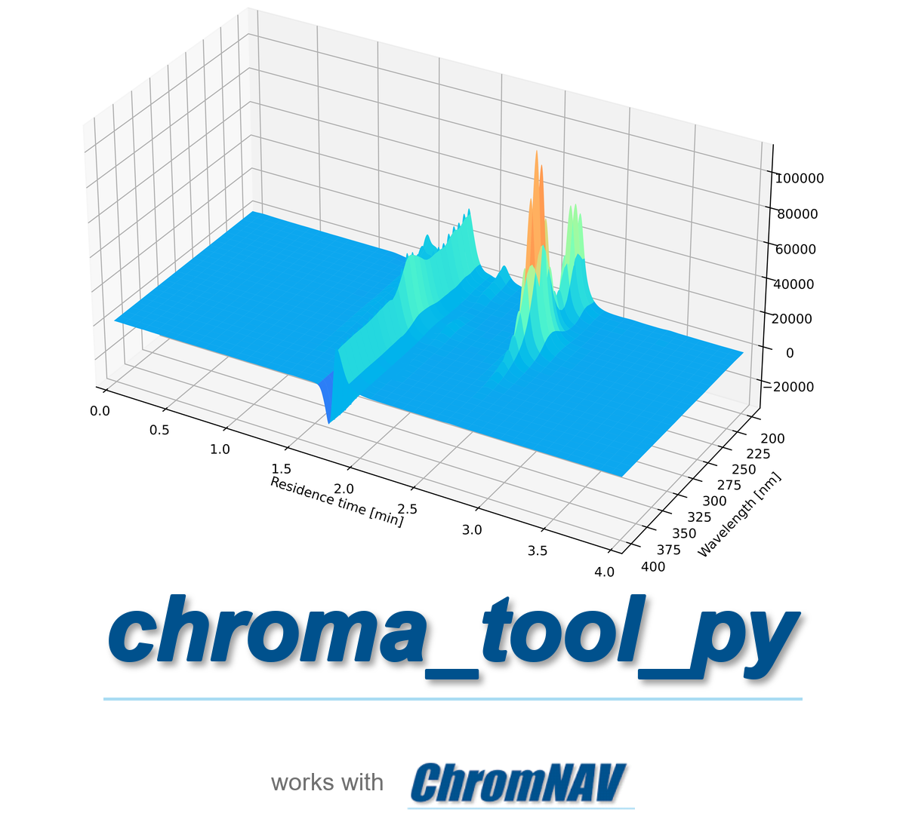

<p align="center">
  
</p>

# chroma_tool_py

Python toolbox to load, plot and post-process HPLC-DAD (PDA) and fluorescence (FL)
chromatograms exported from JASCO **ChromNAV**.

[Espanol](README.es.md) | [Documentation](docs/index.md) | [Roadmap](ROADMAP.md) | [Changelog](CHANGELOG.md)

## Why

ChromNAV exports **one channel per file** (one `.csv` per FL channel, one peak table
per PDA channel, a separate `.txt` for the full PDA surface). Merging those files,
plotting them and collecting peak areas for calibration curves by hand in Excel is slow
and error-prone. `chroma_tool_py` reads the raw exports, builds objects you can work
with in Python, and ships command-line tools to process a whole batch in one command.

## Installation

Requires Python 3.10 or newer.

```bash
pip install git+https://github.com/marcovillegaz/chroma_tool_py.git
```

From a local clone (editable install with the development tools):

```bash
git clone https://github.com/marcovillegaz/chroma_tool_py.git
cd chroma_tool_py
pip install -e ".[dev]"
```

Optional extra for baseline correction (`utils/chroma_corrector.py`, uses `pybeads`):

```bash
pip install "chroma_tool_py[baseline] @ git+https://github.com/marcovillegaz/chroma_tool_py.git"
# or, from a clone: pip install -e ".[baseline]"
```

## Quickstart (library)

The repository includes real PDA exports in `data/DLLME_Chromatograms/`.

```python
from pathlib import Path

from chroma_tool_py import Chromatogram
from chroma_tool_py.display import chroma_plot
from chroma_tool_py.utils import extract, info

# Load a PDA export (.txt)
chroma = Chromatogram.create_from_pda("data/DLLME_Chromatograms/1w_ef_x.txt")
print(chroma.NAME, chroma.PDA_DATA.shape)   # 1w_ef_x (2941, 101)

# Time and wavelength axes, and the signal at one wavelength
time = info.time(chroma.INFO)               # 2941 points, minutes
wavelengths = info.wavelenth(chroma.INFO)   # 200-400 nm, 101 points
signal_254 = extract.by_wavelength(chroma, 254)

# Save plots (without save_path the figure is shown with plt.show())
out = Path("plots")
out.mkdir(exist_ok=True)
chroma_plot.pda_2d(chroma, wavelengths=[250, 300], save_path=str(out))  # 1w_ef_x_2d.png
chroma_plot.pda_contour(chroma, save_path=str(out))                     # 1w_ef_x_PDA.png
```

Fluorescence data (`;`-separated CSV with `min` and `Intensity` columns):

```python
fl = Chromatogram.create_from_fl("path/to/sample (01).csv")
chroma_plot.fl_plot(fl, save_path="plots")
```

## Command-line tools

Three entry points are installed with the package. All of them accept `--help`.

| Command | Purpose |
|---|---|
| `plot-batch-pda` | Plot every PDA `.txt` in a folder (contour and/or 2D at chosen wavelengths) |
| `plot-batch-fl` | Plot every FL `.csv` in a folder |
| `process-chromnav-batch` | Merge per-channel peak tables of a batch into an Excel database table |

```bash
# PDA: contour + 2D plots at 250 and 300 nm for all files in the folder
plot-batch-pda --input data/DLLME_Chromatograms --output plots --mode both --wavelengths 250,300

# FL
plot-batch-fl --input path/to/fl_csv --output plots

# Peak tables (CH1.xlsx, CH2.xlsx, ...) -> existing Excel database
process-chromnav-batch --batch path/to/batch_folder --database path/to/database.xlsx
```

Options, defaults and the database layout are described in [docs/cli.md](docs/cli.md).

## ChromNAV / JASCO format

The parsers expect the raw ChromNAV exports: a tab-separated PDA `.txt` with a key/value
header followed by an `INTENSITY` line and the matrix; FL `.csv` files with `;` separator
and `,` decimals; and peak tables as Excel files named after the channel (`CH1.xlsx`).
Details and export instructions: [docs/chromnav-format.md](docs/chromnav-format.md).
Other vendors are not supported.

## Repository layout

```
src/chroma_tool_py/
  classes/      Chromatogram, Analyte, Sequence (+ tkinter ChromaVisualizer)
  display/      chroma_plot (pda_2d, pda_contour, pda_surface, pda_spectrum, fl_plot), peaks_plot
  io/           merge_pda_channels, merge_peak_tables, update_xlsx_db, rename
  processing/   calibration_curve_params
  utils/        info, extract, peak_finder, excel, chroma_corrector
  cli/          plot_batch_pda, plot_batch_fl, process_chromnav_batch
tests/          pytest suite
examples/       standalone example scripts (some need your own data)
data/DLLME_Chromatograms/   sample PDA exports
docs/           documentation
assets/         logo
```

## Project status

Alpha (0.1.0). See [ROADMAP.md](ROADMAP.md) for planned work and
[CONTRIBUTING.md](CONTRIBUTING.md) to get involved. Released under the MIT license
([LICENSE](LICENSE)).
